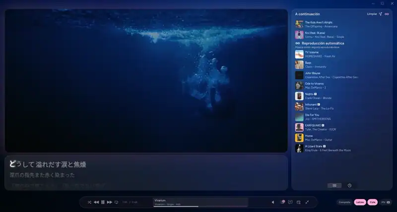
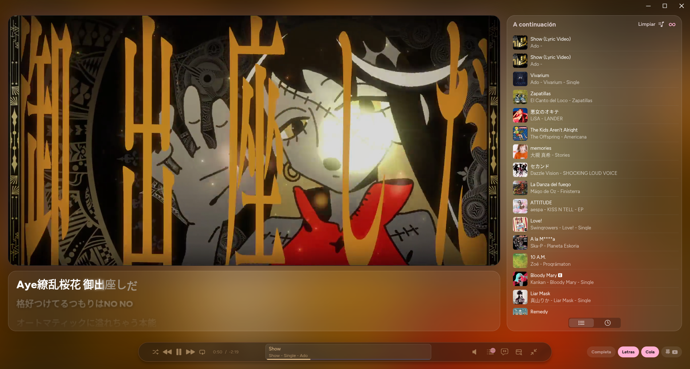
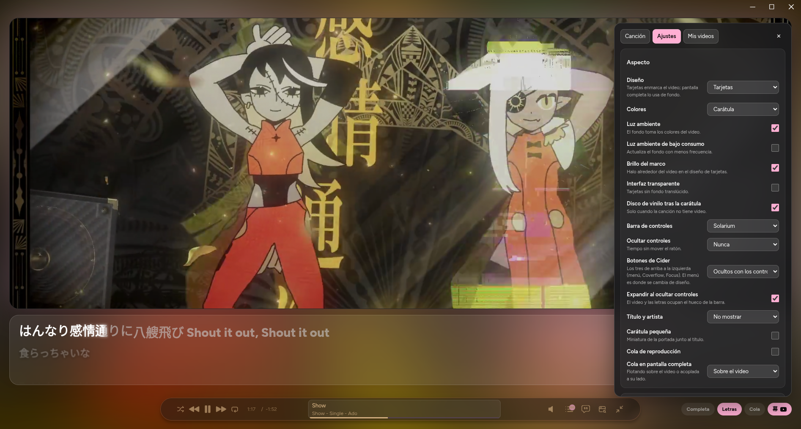

# Maku Clips 幕

Plugin para [Cider](https://cider.sh) que busca el videoclip de la canción que suena y lo reproduce sincronizado con la música dentro de la vista inmersiva, con las letras y la cola al lado. *Maku* (幕) es el telón, la pantalla.



## Qué hace

- Busca solo el videoclip en YouTube y lo mantiene al ritmo del audio: si pausas, adelantas o cambias de canción, el video lo sigue.
- Si Apple Music tiene el videoclip de la canción, puede usar ese en vez del de YouTube.
- Dos diseños: **tarjetas** (video enmarcado, letras debajo y cola a un lado) y **pantalla completa** (letras sobre el video).
- Deja listo el video de la canción siguiente para que el cambio sea inmediato.
- Recuerda qué video le toca a cada canción. Si el automático no es el bueno, eliges otro buscando o pegando un enlace, ajustas el desfase o recortas las franjas negras.
- Canciones sin videoclip: muestra la carátula, con un disco de vinilo opcional.
- Colores tomados de la carátula, del tema de Cider o de la paleta del escritorio; luz ambiente con los colores del video.

## Capturas

| Tarjetas | Pantalla completa |
|---|---|
|  |  |

| Elegir el video | Ajustes | Mis videos |
|---|---|---|
|  |  |  |

## Cómo funciona

Son dos piezas:

- `plugin/`: el plugin de Cider (Vue), que añade el diseño «Maku» a la vista inmersiva.
- `servicio/`: un servicio local en Rust (`maku`) que escucha en `127.0.0.1:3060`. Busca el video con `yt-dlp`, se lo entrega al plugin y guarda la elección de cada canción en `~/.config/maku/mapa.json`.

## Requisitos

- Cider 3 (probado en 3.1.8, en Linux)
- `yt-dlp` y `curl`
- Rust y Node.js para compilar

## Instalación

Servicio:

```sh
cd servicio
cargo build --release
install -Dm755 target/release/maku ~/.local/bin/maku
```

Para que arranque con la sesión, crea `~/.config/systemd/user/maku.service`:

```ini
[Unit]
Description=Videoclips para Maku Clips

[Service]
ExecStart=%h/.local/bin/maku
Restart=on-failure
RestartSec=3

[Install]
WantedBy=default.target
```

```sh
systemctl --user enable --now maku
```

Plugin:

```sh
cd plugin
npm install
npm run build
mkdir -p ~/.config/sh.cider.genten/plugins/mx.sfm.maku
cp dist/plugin.js dist/plugin.yml ~/.config/sh.cider.genten/plugins/mx.sfm.maku/
```

Reinicia Cider, activa «Maku Clips» en los ajustes de plugins y elige el diseño «Maku» en el menú de la vista inmersiva.

## Uso

Los botones de abajo a la derecha cambian entre tarjetas y pantalla completa, y muestran u ocultan las letras y la cola. El botón **幕** abre el panel:

- **Canción**: el video actual, su desfase y recorte, y la búsqueda para elegir otro.
- **Ajustes**: aspecto, video, letras, búsqueda y sincronía.
- **Mis videos**: todas las canciones con video guardado.

## Notas

- Si haces muchas búsquedas seguidas, YouTube puede bloquear las consultas un rato. Se pasa solo en unas horas, o al instante indicando tu navegador en Ajustes → Búsqueda → Cookies de YouTube.
- Algunos videos tienen restricción de edad y solo se pueden ver con esas cookies.
